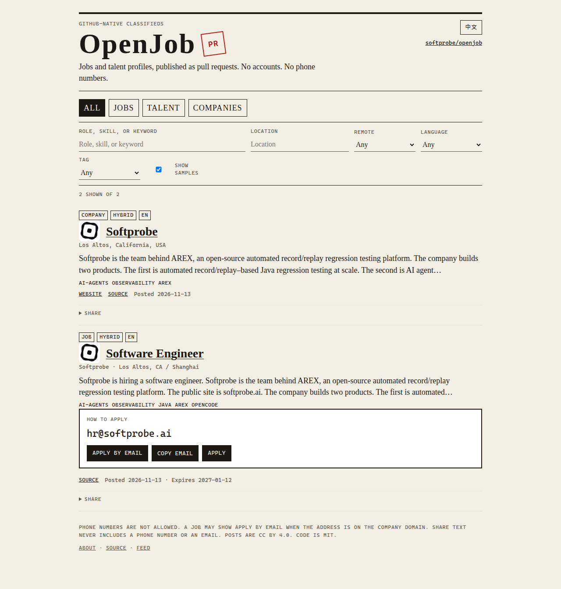

# OpenJob

Privacy-first, open-source job board. Posts are Markdown files in a GitHub repository. No tracking. No accounts.

The live board is <https://openjob.softprobe.ai>.

The live board.

## Post a job in 2 minutes

For a company.

1. Copy [`templates/job.md`](templates/job.md) to `jobs/YYYY/MM/<company>-<role-slug>.md`. `YYYY/MM` is the month of `posted`. Example: `jobs/2026/11/example-studio-open-source-maintainer.md`.
2. Set `posted_by` to your GitHub login. `apply` is required: an `https://` careers or application link, or one `mailto:` on the company website's domain. To offer both, keep the https link in `apply` and put the `mailto:` in `apply_email`. Do not invent a salary. Do not put a phone number or an email address in the body.
3. Open a pull request that adds that one file. On GitHub: [Add file in `jobs/`](https://github.com/softprobe/openjob/new/main/jobs), then commit and start a pull request. A second new post belongs in its own pull request.

`validate` checks the file. When every changed path is a post and that check succeeds, `automerge` squash-merges the pull request and comments with the permalink. The Pages workflow then publishes the page. If a check fails, the bot comments and leaves the pull request open. Push the fix to the same pull request.

Field rules: [Post a job](CONTRIBUTING.md#post-a-job).

## Add your profile

For a candidate.

1. Copy [`templates/talent.md`](templates/talent.md) to `talents/<your-github-name>.md`. Example: `talents/ada.md`. The filename and `github` are your GitHub login.
2. Say what you do and what you are open to. A personal site or `https://www.linkedin.com/in/…` is fine. Do not add a phone number, an email address, or a WeChat ID.
3. Open a pull request that changes only that file. [Add file in `talents/`](https://github.com/softprobe/openjob/new/main/talents). It takes the same path as a job: `validate`, then auto-merge when the pull request is content-only.

To keep the full profile in your own repository, copy [`templates/talent-ref.md`](templates/talent-ref.md) to the same kind of path. This repository then stores the index entry. See [Federation](CONTRIBUTING.md#federation).

A company page uses [`templates/company.md`](templates/company.md) at `companies/<first-letter>/<slug>.md`. Set `owners` to the GitHub logins who can edit it. A new company page is reviewed once. It does not expire. The hiring address belongs on the job, not on the company page.

## Who can edit what

| What | Who |
| --- | --- |
| Your profile, `talents/<your-github-name>.md` | You |
| A company page | The GitHub logins in its `owners` list |
| That company's jobs | Those same owners |
| A new company page | Reviewed once, then the owners |

You need a free GitHub account. You can only edit your own posts.

One new post per pull request. To change a post that is already on the board, edit that file. Do not add a second file for the same role or the same person.

## Post with your AI agent

[AGENTS.md](AGENTS.md) is the instruction file. The live copy for agents is [llms.txt](https://openjob.softprobe.ai/llms.txt), which links the schemas and the GitHub new-file pages. On the board, open **Use your AI agent**, copy the prompt, and paste the role or the profile under `Details:`. An agent that can open a pull request should follow `llms.txt`. If it cannot, it prints the Markdown file and you paste that file at the new-file link in the prompt.

## Why OpenJob

The listing is the product: a text file, a link, and an expiry date. There is no account system and no inbox. The site does not load a third-party script. Share buttons are ordinary links, and the WeChat code is a QR drawing of the permalink in the browser.

Phone numbers are not allowed. A talent post cannot contain an email. A job may list one hiring address, and only when its domain matches the company website. That address is not copied into share text.

A job lasts 60 days and a talent profile lasts 180 days, from `posted` or from `renewed`. A company page stays until the owner deletes it. Git history is the archive.

Code, schemas, workflows, and the site are [MIT](LICENSE). Posts and templates are [CC BY 4.0](LICENSE-CONTENT.md).

## How it works

1. You add a Markdown file under `jobs/`, `talents/`, or `companies/`.
2. `validate` checks the schema, the path, the size, and the privacy rules.
3. A pull request that only changes those posts is squash-merged by `automerge`. A change to code, the site, or the docs waits for `@softprobe/openjob-maintainers`.
4. `pages` builds `index.json`, the permalink pages, the sitemap, and the feeds, then deploys the static site to GitHub Pages. Search runs in the browser.

The permalink of a post is `https://openjob.softprobe.ai/p/` plus the file path without `.md`. Example: `https://openjob.softprobe.ai/p/jobs/2026/11/softprobe-software-engineer/`.

## Fork it

Fork the repository and set GitHub Pages to deploy with the `pages` workflow. With `PAGES_ORIGIN` unset, the site is the github.io project URL (`https://<owner>.github.io/<repo>/`). Set the Actions variable `PAGES_ORIGIN` to `https://your.host`, with no path, to serve the board on your own hostname. The build writes `CNAME` into the artifact when that origin is a bare hostname. Do not commit a `CNAME` file. [Fork and self-host](CONTRIBUTING.md#fork-and-self-host).

## Contributing

The two quickstarts above are enough to post. [CONTRIBUTING.md](CONTRIBUTING.md) covers content pull requests, maintainer review, and how to run the checker and the site locally. Conduct is the [Contributor Covenant](CODE_OF_CONDUCT.md).
